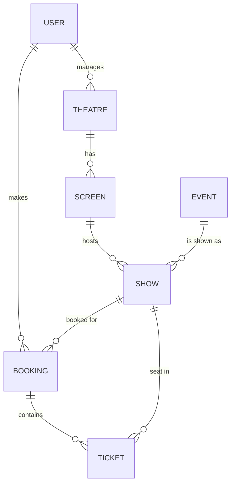

# Ticket Booking System

A REST API for browsing events and booking seats, built with Spring Boot, MySQL and Redis. The focus of the project is **correctness under concurrency** (no double booking) and **measured performance**.

## Tech stack
Java 17 · Spring Boot · Spring Data JPA (Hibernate) · MySQL · Spring Security with JWT · Redis (cache) · springdoc OpenAPI (Swagger) · JUnit 5 · k6 (load testing)

## Features
- Register and log in with JWT authentication
- Browse events, shows and a live seat map (public endpoints)
- Book seats in two phases: **hold** (expires after 10 minutes, configurable) then **confirm** (simulated payment) or **cancel**
- Expired holds are released automatically by a scheduled job
- Paginated booking history
- Admin APIs for theatres, screens, events and shows <<keep or delete>>

## API overview
Swagger UI: `http://localhost:8080/swagger-ui/index.html`

| Method | Endpoint | Description |
|---|---|---|
| POST | `/api/auth/register` | Create an account |
| POST | `/api/auth/login` | Get a JWT |
| GET | `/api/public/events` | List events |
| GET | `/api/public/events/{eventId}/shows` | Upcoming shows for an event |
| GET | `/api/public/shows/{showId}/seats` | Seat map for a show (cached) |
| POST | `/api/bookings/initiate` | Hold seats for a booking |
| POST | `/api/bookings/{id}/confirm` | Confirm payment |
| POST | `/api/bookings/{id}/cancel` | Cancel a pending booking |
| GET | `/api/bookings/history` | Booking history |

## Data model

## Key design decisions
**No double booking.** A unique constraint on `(show, seat_row, seat_number)` makes the database the final authority. Concurrent requests for the same seat result in exactly one success; the others get a clear `409 Conflict`.

**Atomic state changes.** Confirming and cancelling are single conditional `UPDATE` statements (`... WHERE status = 'PENDING' AND expires_at >= now`). A double-click, a late confirm, and the expiry job cannot overwrite each other.

**Deadlock prevention.** Seats are always inserted in sorted order. Without this, two users booking the same two seats in opposite order deadlocked MySQL. Remaining lock failures return a retryable `503` with `Retry-After`.

**Expiring holds.** Each booking stores an `expiresAt`. A scheduled job fails expired bookings and releases their seats.

**Caching.** The seat map uses cache-aside with Redis, evicted **after commit** on every write path (initiate, confirm, cancel, expiry job), with a 10-second TTL as a safety net. The database stays the authority; the cache only affects freshness of what users see. Eviction failures are logged and never fail a booking.

**Constant-cost queries.** Bulk updates and join fetches keep query counts independent of data size (see below).

## Testing
Concurrency tests run against a separate MySQL test database.
- **Same-seat race:** 20 threads book one seat; exactly 1 succeeds. With the unique constraint removed, all 20 succeeded, so the test detects double booking.
- **Opposite-order deadlock test:** the same two seats booked in opposite order deadlocked in 25 of 25 rounds before the fix, and passes in 5 × 25 rounds after it.
- **Time-Travel Sweeper Test:** Verified automated background expiration logic using Mockito clock injections.

## Performance
Measured with k6 on a single laptop (app, MySQL and k6 on one machine), so absolute numbers are indicative only.

| Optimization | Before | After |
|---|---|---|
| Confirm payment (queries per call) | 9 | 6, constant in seats booked |
| Booking history (queries per call) | 8 | 3, constant in bookings |

- **Connection pool is the read bottleneck:** with no cache, seat-map p95 latency was 1.18 s, 186 ms and 28 ms at pool sizes 5, 10 and 30 under a ramp to 1,000 req/s.
- **Cache effect (pool size 10):** p95 fell from 186 ms (no cache) to 44 ms (Redis), at the cost of about 36 ms per call to a remote Redis. A local Redis would remove that cost.
- **Booking endpoint:** a ramp to 200 bookings/s ran with 0 errors and p95 around 41 to 44 ms. Row counts matched afterwards (tickets = bookings created), so nothing was lost or duplicated.

## Running locally
1. Install Java 17+, MySQL, and have a Redis instance available (local or cloud).
2. Set environment variables: `DB_USERNAME`,`DB_PASSWORD`, `JWT_SECERT_KEY`, `REDIS_HOST`, `REDIS_PORT`, `REDIS_PASSWORD`.
3. Run `./mvnw spring-boot:run`, then open the Swagger UI.
4. Run tests with `./mvnw test`. 
## Known limitations and future work
- Payment is simulated; a real gateway would confirm via a signed, idempotent webhook.
- Money uses `Double`; should move to `BigDecimal`.
- Schema is managed by Hibernate; Flyway migrations would be the next step.
- For multiple app instances, the expiry job needs a distributed lock (for example ShedLock).
- Not yet done: CI pipeline, rate limiting, Docker setup.